<!-- ===== Cover banner (animated, self-hosted: banner.svg) ===== -->

  

  

  
  
  

---

## ☕ About Me

<table>
  <tr>
    <td width="48%" valign="middle">
      <ul>
        <li>🔭 Currently focusing on <b>Full-Stack Development</b> with a strong interest in <b>Backend engineering</b>.</li>
        <li>💡 Built solid analytical & problem-solving foundations with <b>C and C++</b>.</li>
        <li>🌱 Actively practicing & building with <b>JavaScript, TypeScript, HTML, CSS & Bootstrap</b>.</li>
        <li>🤖 Passionate about leveraging <b>AI-assisted workflows</b> for faster learning and clean development.</li>
        <li>💬 Ask me about: <b>C / C++, Web Basics, JavaScript, TypeScript</b>.</li>
      </ul>
    </td>
    <td width="52%" align="center" valign="middle">
      
    </td>
  </tr>
</table>

---

## 🚀 Featured Live Project: DIU StudyHub

  
  
  

> **[DIU StudyHub](https://diu-studyhub.vercel.app/)** is an all-in-one centralized academic portal built to help Daffodil International University (DIU) students access lecture notes, study materials, and syllabus resources seamlessly. 
> 
> ⚡ **Architected & Built using Modern AI:** I designed and developed this entire project leveraging an **AI-first workflow**—utilizing advanced AI tools for architectural guidance, modular code structuring, and rapid frontend development.

| Feature | Details |
|---|---|
| 🌐 **Live Website** | [👉 diu-studyhub.vercel.app](https://diu-studyhub.vercel.app/) |
| 🎯 **Core Impact** | Solves student struggles with lost Google Drive links and scattered social group files |
| 🤖 **AI-Augmented** | Built end-to-end utilizing AI pair-programming to accelerate learning and delivery |
| 🛠️ **Tech Stack** | `HTML5` · `CSS3` · `Bootstrap` · `JavaScript` · `Vercel Deployment` |

---

## 🛠️ Technologies & Tools

  

---

## 🎯 What I Want to Learn Next (Future Interests)

| 🧩 System Architecture | 🧠 LLMs & Applied AI | ⚙️ Advanced Backend |
|:---:|:---:|:---:|
| How large-scale, high-availability backends are designed and structured | How LLMs operate under the hood & how to integrate AI agents into apps | RESTful APIs, relational databases, caching & microservice patterns |

---

## 📊 GitHub Stats & Streaks

  
  

  

  

<i>Thanks for stopping by, let's build something great together. ✨</i>

